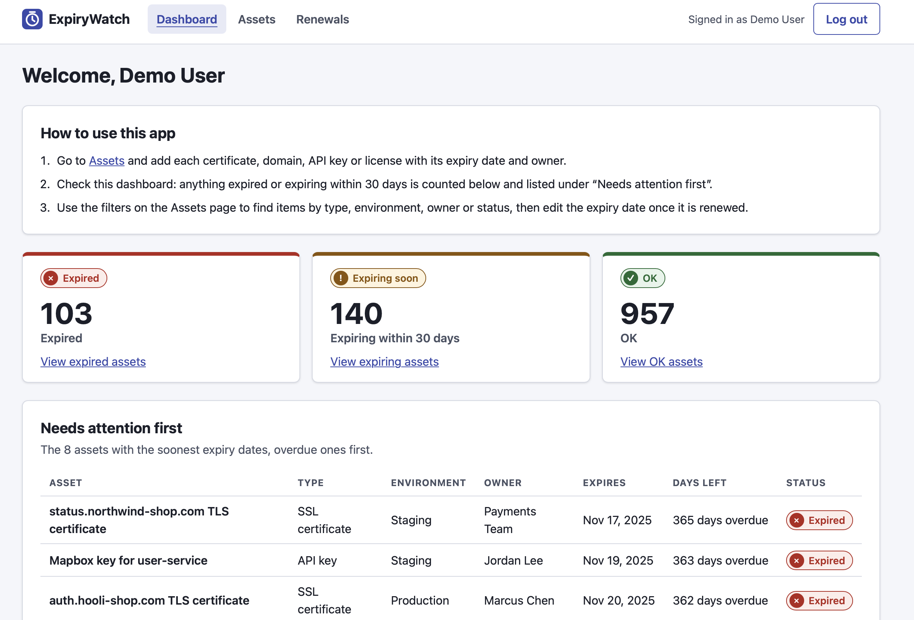

# ExpiryWatch

A web app that tracks SSL certificates, domains, API keys and licenses so a team can renew them before they expire.

## Author

Rishabh Tiwari and Dins Patel

## Class

CS 5610 Web Development, Northeastern University, Fall 2026

[https://johnguerra.co/classes/webDevelopment_online_fall_2026/](https://johnguerra.co/classes/webDevelopment_online_fall_2026/)

## Project objective

Teams lose track of when their certificates, domains and API keys expire, and the first sign is often an outage or a locked account. ExpiryWatch keeps every expiring item in one place with its owner, environment and expiry date. A dashboard shows what has already expired and what expires within the next 30 days, so the right person can renew it in time.

## Live site

[https://expirywatch-zzyy.onrender.com/](https://expirywatch-zzyy.onrender.com/)

## Screenshot



## Features

- **Accounts.** Register and log in with email and password, handled by Passport with a local strategy. Passwords are hashed with bcryptjs, and sessions are stored in MongoDB. Registering logs you in right away.
- **Assets.** Create, view, edit and delete assets. Each asset has a name, a type (SSL certificate, domain, API key, license or other), an environment (production, staging or development), an owner, an expiry date and optional notes. You only ever see and change your own assets.
- **Search and filters.** Search assets by name and filter by type, environment, owner and status (expired, expiring within 30 days, or OK). Sort by expiry date, name or date added. Results are paginated.
- **Expiry dashboard.** Counts of expired, expiring and OK assets, plus a "Needs attention first" table of the eight assets with the soonest expiry dates, showing how many days are left or overdue.
- **Renewals.** Log each renewal with the asset name, type, who renewed it, the renewal date and the new expiry date. Create, view, edit and delete renewals, search by asset name, and filter by type, the person who renewed it, and a date range. The list shows the newest renewals first and is paginated.
- **Seeded data.** Seed scripts create a demo account with 1,200 realistic sample assets, spread across expired, expiring soon and later dates, and 1,100 renewals of those assets over the last year by ten different people.

Status is always shown with a word and a symbol, not by color alone.

## Demo account

| Email                  | Password         |
| ---------------------- | ---------------- |
| `demo@expirywatch.dev` | `ExpiryDemo2026` |

This account is for the demo only. It is created by the seed scripts.

## Tech stack

- **Frontend:** React with hooks, react-router-dom, prop-types, built with Vite.
- **Backend:** Node.js, Express, the native MongoDB Node.js driver, Passport (local strategy), express-session, connect-mongo and bcryptjs.
- **Database:** MongoDB Atlas.
- **Hosting:** Render.

The project does not use axios, Mongoose or the cors package. In development, Vite proxies `/api` requests to the backend. In production, Express serves the built frontend from `frontend/dist`, so the app and the API share one origin.

## Project structure

```text
expirywatch/
├── backend/
│   ├── auth/          Passport setup and the requireAuth middleware
│   ├── db/            MongoDB connection and index setup
│   ├── lib/           Validation, ObjectId parsing and pagination helpers
│   ├── routes/        auth.js, assets.js and renewals.js (/api/auth, /api/assets, /api/renewals)
│   ├── scripts/       seed.js, seed-renewals.js and check-db.js
│   ├── server.js      Express app
│   └── .env.example   Template for the environment variables
├── frontend/
│   ├── public/        favicon.svg
│   ├── src/
│   │   ├── components/  Reusable components, each with its own CSS file
│   │   ├── context/     AuthContext and the useAuth hook
│   │   ├── pages/       Login, Register, Dashboard, Assets and Renewals pages
│   │   ├── api.js       The only module that calls the backend
│   │   ├── App.jsx      Routes
│   │   └── main.jsx     Entry point
│   ├── index.html
│   └── vite.config.js
├── eslint.config.js   ESLint config for the backend
├── .prettierrc.json   Prettier config shared by both folders
└── LICENSE
```

## Instructions to build and run

### Prerequisites

- Node.js 20.19 or higher
- A MongoDB Atlas database, with your IP address allowed in the Atlas network access list

### 1. Clone the repository

```bash
git clone https://github.com/rishabht877/expirywatch.git
cd expirywatch
```

### 2. Create the environment file

Copy the example file and fill in your own values:

```bash
cp backend/.env.example backend/.env
```

| Variable         | What it is for                                                       | Example placeholder                                   |
| ---------------- | -------------------------------------------------------------------- | ----------------------------------------------------- |
| `MONGODB_URI`    | Connection string for your MongoDB Atlas cluster                     | `mongodb+srv://<username>:<password>@<cluster-host>/` |
| `DB_NAME`        | Name of the database to use                                          | `expirywatch`                                         |
| `SESSION_SECRET` | Long random string used to sign session cookies                      | `<random-64-char-hex-string>`                         |
| `PORT`           | Port the backend listens on                                          | `3000`                                                |
| `DEMO_PASSWORD`  | Password the seed script gives the demo account (8 to 72 characters) | `<demo-password>`                                     |

One way to generate a session secret is `openssl rand -hex 32`. If your database password has special characters, URL encode it in `MONGODB_URI`.

You can check the connection with:

```bash
cd backend
npm run check-db
```

### 3. Install dependencies

```bash
cd backend && npm install
cd ../frontend && npm install
```

### 4. Seed the database

Run these once, in this order, from the `backend` folder:

```bash
npm run seed
npm run seed:renewals
```

The first creates the demo account and 1,200 sample assets, along with the database indexes. The second adds 1,100 renewals of those assets. Each script checks first: if the demo account already has 1,000 or more assets (or renewals), it prints a message and adds nothing.

### 5. Run in development

Open two terminals.

```bash
# Terminal 1
cd backend
npm run dev
```

```bash
# Terminal 2
cd frontend
npm run dev
```

The backend runs on port 3000. Vite prints the frontend address, usually [http://localhost:5173](http://localhost:5173), and forwards every `/api` request to the backend.

### 6. Build and run in production

```bash
cd frontend
npm run build
cd ../backend
NODE_ENV=production npm start
```

Express then serves the app and the API together on `PORT`. In production the session cookie is marked secure, so logging in needs HTTPS. Render provides that.

### 7. Deploy on Render

Create a Web Service from this repository with these settings:

- **Build command:**
  ```bash
  cd frontend && npm install --include=dev && npm run build && cd ../backend && npm install
  ```
- **Start command:**
  ```bash
  cd backend && npm start
  ```
- **Environment variables:** `MONGODB_URI`, `DB_NAME`, `SESSION_SECRET` and `NODE_ENV=production`. Add `DEMO_PASSWORD` only if you run the seed script from Render. Render sets `PORT` itself.

`--include=dev` is needed because Vite is a dev dependency, and npm skips dev dependencies when `NODE_ENV` is `production`. In MongoDB Atlas, allow access from Render, for example with `0.0.0.0/0`.

### Linting and formatting

Both folders have the same scripts:

```bash
npm run lint
npm run format
```

## Design document

[Design document (PDF)](docs/design-doc-p3.pdf)

## License

This project is licensed under the MIT License. See [LICENSE](LICENSE).
